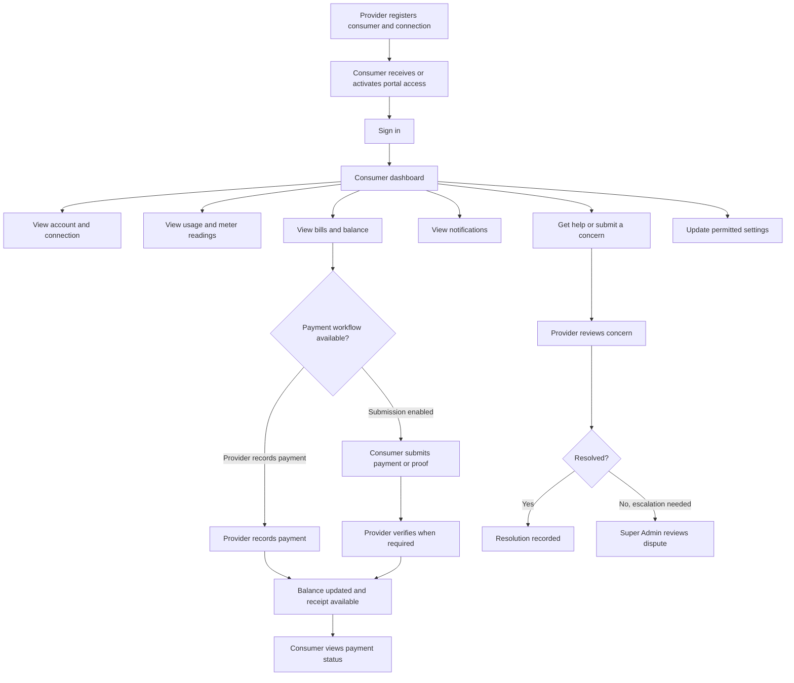
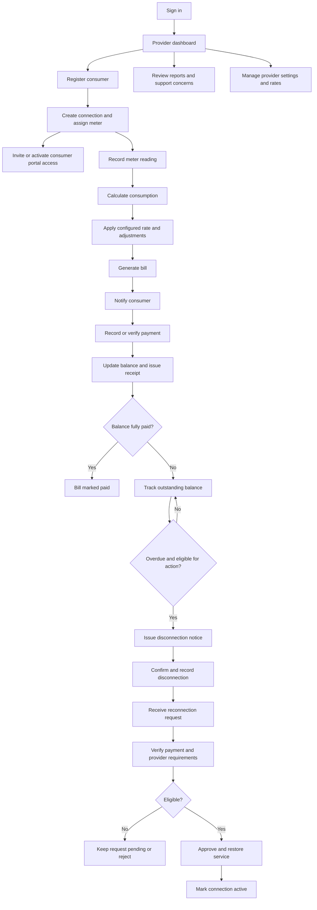
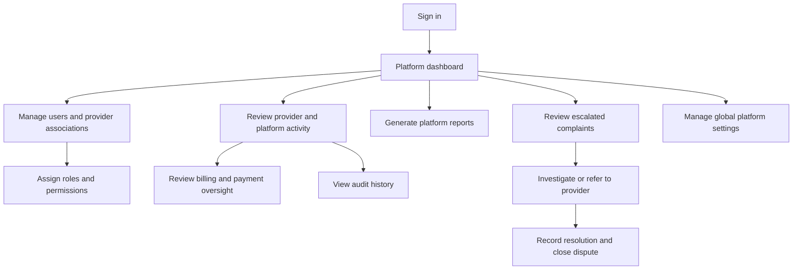

# AquaFlow User Flows

These diagrams describe the planned system in [PRODUCT.md](PRODUCT.md) and [plan.md](plan.md). The application currently has a public preview, authentication, account settings, and a placeholder dashboard. The water management features below are planned.

## Consumer

The consumer's journey starts after a provider registers their water account and enables portal access.

## Water provider

The provider manages the operational cycle for its own consumers.

A partial payment reduces the balance but does not mark the bill as paid. Recording a payment alone does not automatically restore disconnected service.

## Super Admin

The Super Admin oversees the platform and handles issues escalated beyond a provider.

Provider staff should only access their own provider's records, while consumers should only access their own account information. These access rules are part of the planned system.
